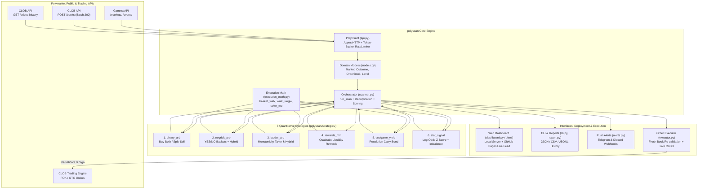

# Software Architecture & Operations Guide (EN / ไทย)

---

## 1. System Architecture Diagram



---

## 2. Module Reference (English / ภาษาไทย)

| File / Module | Responsibility (EN) | หน้าที่หลัก (TH) |
| :--- | :--- | :--- |
| `polyscan/config.py` | Dataclass-based configuration loader (`config.json` + CLI flags + env vars). | โหลดค่าตั้งต้น พารามิเตอร์ความเสี่ยง และ API/Webhook จากไฟล์และตัวแปรแวดล้อม |
| `polyscan/api.py` | Async `aiohttp` client with dual Token-Bucket rate limiters, exponential backoff, and 200-token batch `/books` fetching. | ตัวดึงข้อมูลความเร็วสูงแบบ Async พร้อมระบบจำกัดอัตราการยิง API และดึง Order Book ครั้งละ 200 ตลาด |
| `polyscan/models.py` | Strongly-typed `Market`, `Outcome`, `OrderBook`, `Level` parsers with active reward date filtering. | แปลงข้อมูล JSON จาก Gamma/CLOB เป็นอ็อบเจกต์พร้อมคำนวณ Spread, Depth, Imbalance และกรองวันหมดอายุรางวัล |
| `polyscan/execution_math.py` | Exact fee curve (`taker_fee`) and multi-leg orderbook depth simulator (`basket_walk`, `walk_single`). | จำลองการกวาดซื้อ/ขายทุกชั้นราคาในสมุดคำสั่งพร้อมหักค่าธรรมเนียมจริงทีละชั้น |
| `polyscan/scanner.py` | End-to-end scan pipeline, NegRisk completeness checker, deduplication, and unified scoring. | ตัวควบคุมการสแกนทั้งหมด ตรวจสอบความครบถ้วนของกลุ่มตลาด NegRisk และจัดอันดับโอกาสทำกำไร |
| `polyscan/executor.py` | Pre-trade live orderbook re-validation, tick/lot rounding, thin-leg-first FOK execution, and hybrid GTC+FOK staging. | ตรวจสอบราคาสดซ้ำก่อนยิงออเดอร์ ปัดเศษขนาดคำสั่ง และส่งออเดอร์จริงผ่าน `py-clob-client` |
| `polyscan/dashboard.py` | Local `aiohttp` web server running background scan loops and serving `/api/result`. | เว็บเซิร์ฟเวอร์ในเครื่องที่รันสแกนอัตโนมัติเป็นพื้นหลังและแสดงผลแบบ Real-Time |
| `polyscan/dashboard.html` | Bilingual (TH/EN) single-page web UI compatible with both local `/api/result` and static `./latest.json` (GitHub Pages). | หน้าเว็บ Dashboard สองภาษา รองรับทั้งการรันในเครื่องและโฮสต์บน GitHub Pages |

---

## 3. Deployment & Production Operations (EN / ไทย)

### A. Cloud Static + Scheduled Live Feed (GitHub Actions + GitHub Pages)
- Workflow `.github/workflows/deploy-pages.yml` automatically runs every 30 minutes (and on every push or manual dispatch), executes `python3 -m polyscan scan`, bundles `latest.json` + `latest.csv` alongside `index.html`, and deploys to **GitHub Pages**.
- ระบบตั้งค่า GitHub Actions ให้รันสแกนตลาดสดทุกๆ 30 นาที และอัปเดตข้อมูลขึ้นหน้าเว็บ GitHub Pages อัตโนมัติโดยไม่ต้องเปิดเครื่องทิ้งไว้

### B. Always-On Container Deployment (Docker / Railway / Render / VPS)
```bash
docker build -t polyscan .
docker run -d --restart unless-stopped -p 8080:8080 --name polyscan polyscan
```

### C. Telegram & Discord Real-Time Alerts
```bash
export TELEGRAM_BOT_TOKEN="123456:ABC-DEF..."
export TELEGRAM_CHAT_ID="-100123456789"
export DISCORD_WEBHOOK="https://discord.com/api/webhooks/..."
python3 -m polyscan watch --interval 30
```
